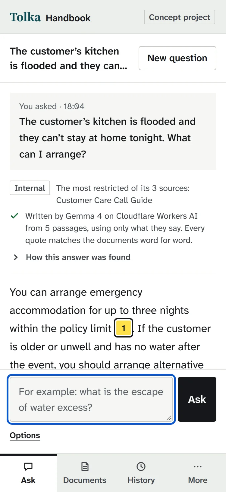
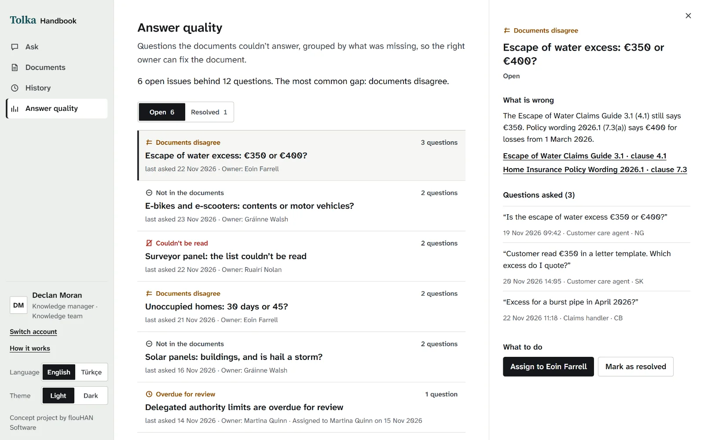

# Tolka Handbook · document assistant

A concept web app by [flouHAN Software](https://flouhan.com): the internal document assistant of a home insurer. Staff ask a question and get an answer written only from the company's own documents, with the source behind every sentence. The insurer, its people and its documents are made up; the documents were written for this project.

- **Live demo:** https://flouhan.com/demo/dokuman-asistani/
- **Case study, with a walkthrough:** https://flouhan.com/en/work/document-assistant/

[](https://flouhan.com/en/work/document-assistant/)

## What it does

- **Ask.** The answer streams onto the screen as it is written. Once it is checked, every claim carries a source number; click it and the document opens at that clause, marked in yellow. The assistant's own words are in plain type; the document's words are quoted in a serif, and each quote is checked against the document letter by letter. A quote that doesn't match is dropped.
- **Search by wording and by meaning.** A question in Turkish that says the customer "can't stay at home" still finds the English clause that says "cannot be lived in".
- **Conflicts and dates.** When two documents disagree (the claims guide says €350, the policy says €400), the answer gives both with their sources and says which one applies. A date of loss can be added: before 1 March 2026 the 2024.2 policy wording applies, and the answer says so.
- **Your own document.** From the Ask screen you can add a PDF or a Word file and ask only that document. It is read in the browser and stays there; scanned, password-protected and empty files each get their own message. It can be in Turkish: a made-up company's staff handbook in Turkish ships as a sample, next to a Word sample with a list and a table.
- **Documents.** Each document has an owner, a review date and a version history. Overdue reviews are flagged, two versions compare word for word, and any document can be the only one searched.
- **History** keeps earlier conversations, per account.
- **Answer quality** is for the Knowledge team only. Questions the documents couldn't answer are grouped by what was missing (documents disagree, not covered, out of date, unreadable, unhelpful), with the real questions behind each group, an owner to assign and a resolve step.

The demo opens straight on the Ask screen as a claims handler. There are four demo accounts with no password: a customer care agent, a claims handler, a fraud investigator and a knowledge manager. Each role opens different documents, search only runs over those, and a document a role can't open is never named in its answers.

The interface is in English and Turkish, with a light and a dark theme. On a wide screen the first-visit guide opens as a side panel, so the Ask screen stays usable behind it. The **About this project** screen lists how to use the app, the work behind it, and the languages and tools it was built with.


## How an answer is made

1. **Search, in the browser.** Two rankings, merged with Reciprocal Rank Fusion, keeping the best passage per clause:
   - BM25 over clauses (each clause is a passage, tables row by row), with English and Turkish stemming, a Turkish-to-English glossary and a small boost for the asker's role ([`src/lib/search.ts`](src/lib/search.ts));
   - meaning search: the question is turned into a vector by `@cf/baai/bge-m3` (multilingual) through `POST /api/handbook/embed`, and compared with the passages' vectors ([`src/lib/vectors.ts`](src/lib/vectors.ts)). The company documents' vectors ship with the app (`public/vectors/seed.json`, 8-bit with a scale each); an added document's are computed when it is added and kept in the browser.

   Only documents the role can open are searched ([`src/data/ask.ts`](src/data/ask.ts)).
2. **Writing.** The best five passages go to `POST /api/handbook/answer` ([`server/handbook.js`](server/handbook.js)). Gemma 4 (`@cf/google/gemma-4-26b-a4b-it`) on Cloudflare Workers AI writes a short answer from those passages only, numbers every sentence, and answers "none" when they don't cover the question. The answer is streamed to the browser as server-sent events while it is written.
3. **Checking.** Before the model runs, the server checks every passage against [`server/handbook-corpus.json`](server/handbook-corpus.json) (a SHA-256 of each passage and who may open each document): the passage must match its document exactly and the asker's role must be allowed to open it, otherwise the request is refused. After the model answers, quotes are looked up verbatim in the passages; anything not found is removed and counted.
4. **Limits.** A Durable Object (`HandbookMeter`, SQLite storage) keeps a daily budget of 8,000 Neurons (Workers AI gives 10,000 a day for free), 40 questions per IP per day and a same-day cache. When a limit is reached, or the connection drops, the app switches to word search and says why. In local development the cache never expires, so repeated checks and recordings don't use the account's allowance again.

The demo has no passwords, so the role comes from the browser; in a real deployment it comes from the company's sign-in, and the documents themselves stay on the server. Documents you add yourself never leave your browser except as the passages sent with a question, and their text for the meaning vectors.

## Scale

`npm run bench` measures the app's own search code on an archive grown by copying the 11 documents. On the machine it was built on (Node 24, Windows):

| | |
|---|---|
| Archive | 50,220 passages (1,980 documents) |
| Building the word index | about 0.5 s |
| Word search, per question | about 36 ms |
| Meaning search, per question (1024 dimensions) | about 45 ms |

The copies repeat their content, so this measures speed, not quality. At that size the 8-bit vectors take about 50 MB; past it, they would move from the browser to an index on the server.



## Running it

Node 22 or newer.

```sh
npm install
npm run dev        # http://localhost:5192 (word search only unless the server below is running)
npm run server     # build, then the app and the answer service on http://localhost:8787
npm run deploy     # to your own Cloudflare account
```

To let the dev server on 5192 reach the answer service on 8787, copy `.dev.vars.example` to `.dev.vars` before `npm run server`. Workers AI calls go to your Cloudflare account even in local development, so they count against its daily allowance (the local cache keeps that to the first run).

## Checks

```sh
npm run check            # every screen at 1440, 1024 and 375 px in both languages and themes,
                         # axe-core against WCAG 2.1 AA, then navigation, documents, PDF and Word upload,
                         # search answers, the document viewer, roles, answer quality and the guide;
                         # the model and meaning search too when npm run server is running
npm run shots            # screenshots
npm run video -- en      # records the walkthrough from the running demo; video-phone for the phone cut
npm run bench            # search speed on a 50,000-passage archive
npm run samples          # rebuilds the sample PDF and Word files in public/samples/
npm run corpus           # rebuilds server/handbook-corpus.json after the documents change
npm run vectors          # rebuilds public/vectors/seed.json (needs npm run server)
```

Screenshots, reports and videos are written to `output/`.


## Layout

```
src/
  App.tsx          routes and the role guard
  components/      shell, sign-in, guide, document view
  data/            documents (data/docs/), library, answers and retrieval, conversations, answer quality
  lib/             word and meaning search, glossary, dates, PDF and Word reading, model client, streaming,
                   version diff, i18n, routing
  pages/           one folder per screen
server/            Cloudflare Worker and the Durable Object
scripts/           Playwright checks, screenshots, video recording, benchmark, data builders
```

Comments in the source are written in Turkish.



## Licence

© 2026 flouHAN Software. All rights reserved. The code is published to be read and reviewed; it may not be copied, changed or used without written permission. See [LICENSE](LICENSE).
