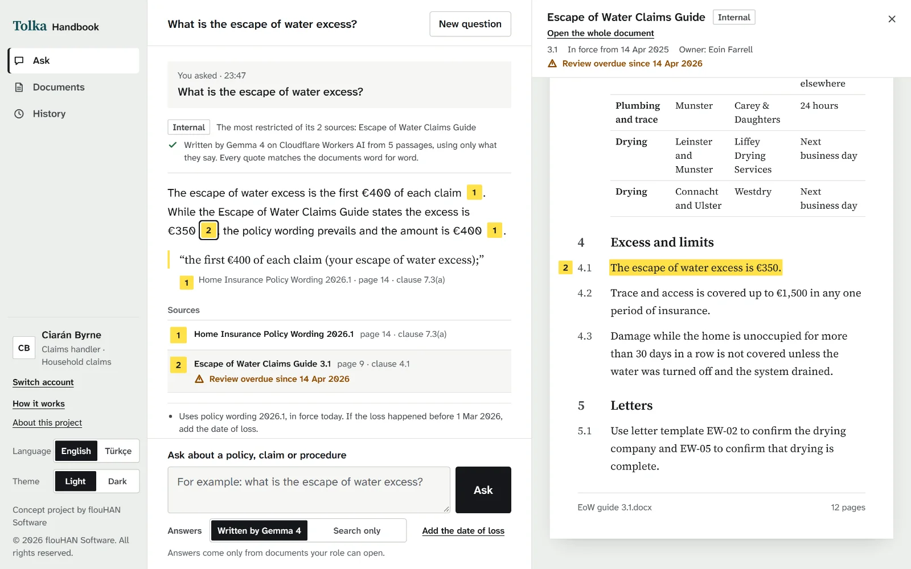
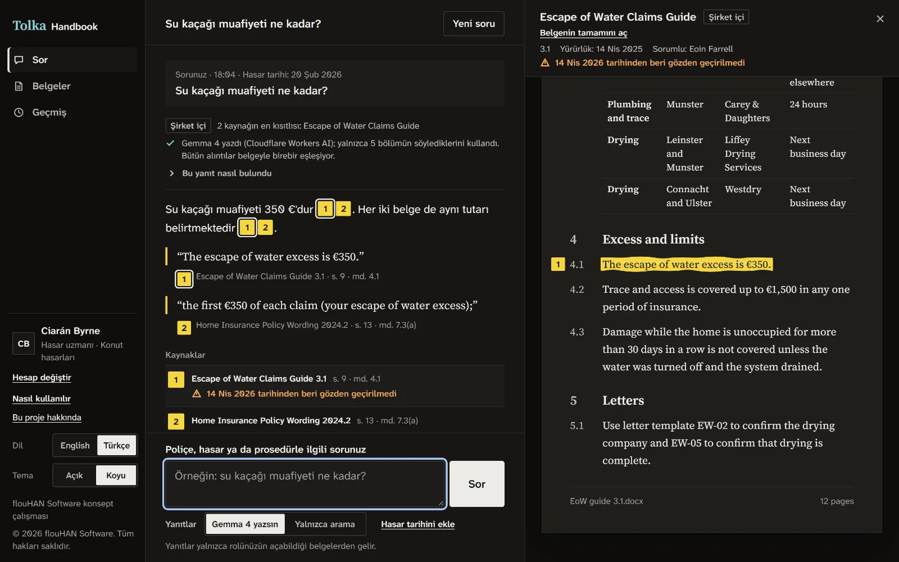
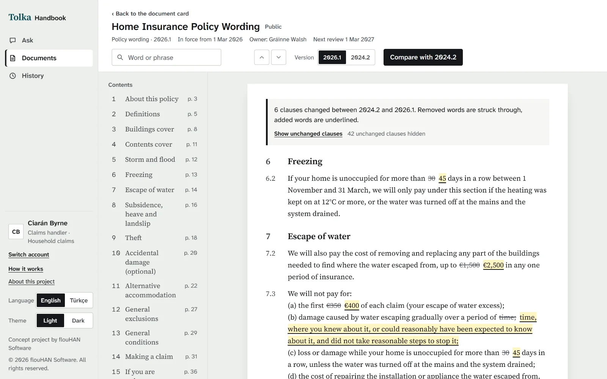

# Tolka Handbook · document assistant

A concept web app by [flouHAN Software](https://flouhan.com): the internal document assistant of a home insurer. Staff ask a question and get an answer written only from the company's own documents, with the source behind every sentence. The insurer, its people and its documents are made up; the documents were written for this project.

- **Live demo:** https://flouhan.com/demo/dokuman-asistani/
- **Case study, with a walkthrough:** https://flouhan.com/en/work/document-assistant/

[](https://flouhan.com/en/work/document-assistant/)

## What it does

- **Ask.** Every claim in an answer carries a source number. Click it and the document opens at that clause, marked in yellow. The assistant's own words are in plain type; the document's words are quoted in a serif, and each quote is checked against the document letter by letter. A quote that doesn't match is dropped.
- **Conflicts and dates.** When two documents disagree (the claims guide says €350, the policy says €400), the answer gives both with their sources and says which one applies. A date of loss can be added: before 1 March 2026 the 2024.2 policy wording applies, and the answer says so.
- **Documents.** Each document has an owner, a review date and a version history. Overdue reviews are flagged, and two versions compare word for word. You can add your own PDF: it is read in the browser with pdf.js, and scanned, password-protected and empty files each get their own message.
- **History** keeps earlier conversations, per account.
- **Answer quality** is for the Knowledge team only. Questions the documents couldn't answer are grouped by what was missing (documents disagree, not covered, out of date, unreadable, unhelpful), with the real questions behind each group, an owner to assign and a resolve step.

There are four demo accounts with no password: a customer care agent, a claims handler, a fraud investigator and a knowledge manager. Each role opens different documents, search only runs over those, and a document a role can't open is never named in its answers.

The interface is in English and Turkish, with a light and a dark theme. Questions can be asked in Turkish: the answer comes back in Turkish and the quotes stay in the documents' English. A short guide opens on the first visit, and the **About this project** screen lists how to use the app, the work behind it, and the languages and tools it was built with.



## How an answer is made

1. **Search, in the browser.** BM25 over clauses (each clause is a passage, tables row by row), with stemming, a Turkish-to-English glossary for Turkish questions and a small boost for the asker's role. Only documents the role can open are searched. See [`src/lib/search.ts`](src/lib/search.ts) and [`src/data/answer.ts`](src/data/answer.ts).
2. **Writing.** Up to six passages go to `POST /api/handbook/answer` ([`server/handbook.js`](server/handbook.js)). Gemma 4 (`@cf/google/gemma-4-26b-a4b-it`) on Cloudflare Workers AI writes a short answer from those passages only, numbers every sentence, and answers "none" when the passages don't cover the question.
3. **Checking.** Quotes are looked up verbatim in the passages; anything not found is removed and counted.
4. **Limits.** A Durable Object (`HandbookMeter`, SQLite storage) keeps a daily budget of 8,000 Neurons (Workers AI gives 10,000 a day for free), 40 questions per IP per day and a same-day cache. When a limit is reached, or the connection drops, the app switches to search mode and says why.

In this demo, access control runs in the browser. A real deployment enforces it on the server, before any passage leaves it.


## Running it

Node 22 or newer.

```sh
npm install
npm run dev        # http://localhost:5192 (search mode unless the server below is running)
npm run server     # build, then the app and the answer service on http://localhost:8787
npm run deploy     # to your own Cloudflare account
```

To let the dev server on 5192 reach the answer service on 8787, copy `.dev.vars.example` to `.dev.vars` before `npm run server`. Workers AI calls go to your Cloudflare account even in local development, so they count against its daily allowance.

## Checks

```sh
npm run check            # every screen at 1440, 1024 and 375 px in both languages and themes,
                         # axe-core against WCAG 2.1 AA, then navigation, documents, PDF upload,
                         # search answers, the document viewer, roles, answer quality and the guide;
                         # the model path too when npm run server is running
npm run shots            # screenshots
npm run video -- en      # records the walkthrough from the running demo; video-phone for the phone cut
npm run samples          # rebuilds the sample PDFs in public/samples/
```

Screenshots, reports and videos are written to `output/`.



## Layout

```
src/
  App.tsx          routes and the role guard
  components/      shell, sign-in, guide, document view
  data/            documents (data/docs/), library, answers, conversations, answer quality
  lib/             search, glossary, dates, PDF reading, model client, version diff, i18n, routing
  pages/           one folder per screen
server/            Cloudflare Worker and the Durable Object
scripts/           Playwright checks, screenshots and video recording
```

Comments in the source are written in Turkish.


## Licence

© 2026 flouHAN Software. All rights reserved. The code is published to be read and reviewed; it may not be copied, changed or used without written permission. See [LICENSE](LICENSE).
